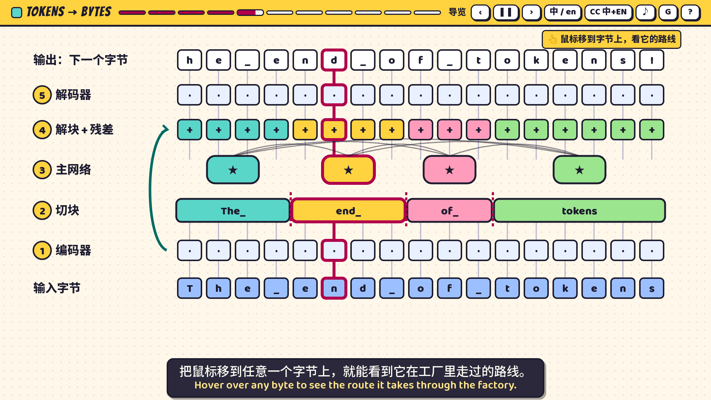
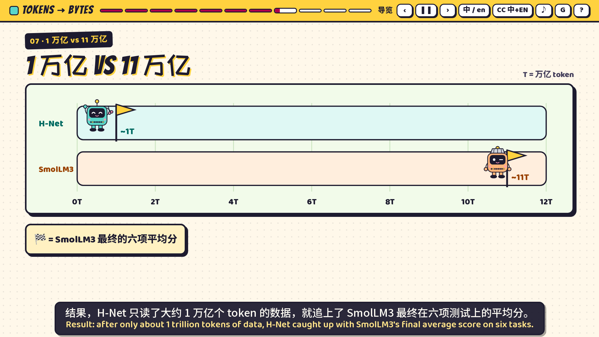

# 从词元到字节：读懂 H-Net · From Tokens to Bytes

**在线播放 / Watch online:** https://2023anita.github.io/tokens-to-bytes/

一份给高中生和普通读者的互动漫画课件，讲解 Cartesia Research 博客文章
[From Tokens to Bytes I: Scaling Hierarchical Networks](https://www.cartesia.ai/blog/from-tokens-to-bytes-part-1)（2026-10-28）。
原创机器人角色「小字节」带你看懂：AI 为什么要先“切词”，BPE 怎么切，H-Net 如何直接从字节里自己学会分块，以及它在代码、陌生语言、DNA 和图像上的表现。

An interactive comic-style explainer for high-school students and general readers, based on Cartesia Research's blog post *From Tokens to Bytes I* (2026-10-28).

## 内容 / Contents
- 11 章，约 13 分钟自动导览 + 自由探索 · 11 chapters, ~13-min guided tour + free exploration
- 中文配音（温暖女声），中英双语字幕可切换 · Mandarin narration, switchable zh/en subtitles
- BPE 合并小游戏、H-Net 工厂路线、计算效率赛跑、编程语言对比、DNA 串珠、测验与术语表
- 单个 HTML 文件，离线可用（下载 `index.html` 直接双击打开）· Single self-contained HTML, works offline

## 操作 / Controls
`←/→` 翻页 · `Space` 暂停/播放 · `Esc` 自由探索 · `S` 字幕 · `L` 界面语言 · `M` 音乐 · `G` 术语表 · `P` 讲稿 · `?` 帮助
首次播放需点击一次（浏览器自动播放限制）。Click once to start audio.

## 说明 / Notes
- 依据公司研究博客，非同行评审论文；“约 10 倍”仅指特定 H-Net 与 SmolLM3-3B 在六项任务上的比较，作者也承认公平比较仍有争议。
- 原文图片版权归 Cartesia；本课件所有图示均依据文中数字用代码重绘，未注明数据的形状标为“示意”。
- Based on a company research blog, not a peer-reviewed paper. All figures are redrawn in code from numbers stated in the text; shapes without stated data are marked “示意 / illustrative”.
- 配音由 MiniMax 语音合成；背景音乐为原创合成。Narration synthesized with MiniMax TTS; original synthesized music.
